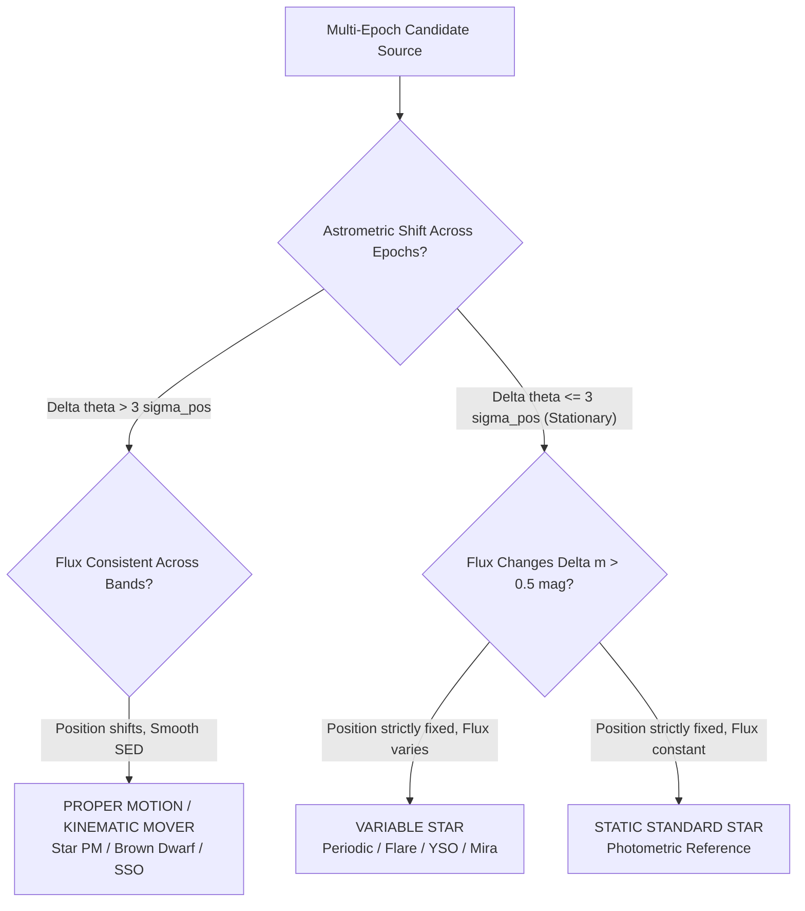

# SkyTrace: Scientific Methodology & Mathematical Formulations

> **Authoritative Specification Reference:** This document provides the mathematical foundations and architectural application of the full scientific specification in [`docs/SCIENCE.md`](file:///Users/macos/Desktop/Nasa%20challenge/docs/SCIENCE.md) (Spec Section 6.4: Scientific Methodology) and the pure-science computational engine in [`science/sphx_core/`](file:///Users/macos/Desktop/Nasa%20challenge/science/sphx_core/).
> 
> Ground truth benchmark reference values for all mandatory validation targets are cataloged and pinned in [`tests/science/reference_values.json`](file:///Users/macos/Desktop/Nasa%20challenge/tests/science/reference_values.json) with formal citations from Gaia DR3, 2MASS, AllWISE, CatWISE2020, and JPL Horizons.

---

## 0. SPHEREx Physical Facts & Observational Constraints (§0)

| Parameter | Nominal SPHEREx Specification | Scientific Consequence & Architectural Constraint |
|---|---|---|
| **Aperture** | 20 cm | Diffraction limit $1.22 \lambda / D \approx 1.0^{\prime\prime}$ (at $0.75\,\mu\text{m}$) to $6.3^{\prime\prime}$ (at $5.0\,\mu\text{m}$). |
| **Detectors** | 6 × H2RG $2048 \times 2048$ arrays (2 focal planes via dichroic) | Arrays 1–3 (short-$\lambda$: 0.75–2.42 $\mu\text{m}$), Arrays 4–6 (long-$\lambda$: 2.42–5.00 $\mu\text{m}$). Each array has independent pixel response, quantum efficiency, and geometric distortion. |
| **Pixel Scale** | $\approx 6.15^{\prime\prime} - 6.20^{\prime\prime}$ / pixel | PSF is undersampled $\Rightarrow$ Centroiding is subject to pixel-phase astrometric bias. Astrometric floor for well-measured isolated point sources is $\sigma_{floor} \approx 0.1^{\prime\prime} - 0.3^{\prime\prime}$. Unresolved binaries with separations $< 10^{\prime\prime}$ form a single blended photocenter. |
| **Cadence** | Full sky covered every $\approx 6$ months | 2 epochs per year for the majority of the sky. Proper motions measured exclusively over SPHEREx baselines carry uncertainties of $\approx 0.1^{\prime\prime} - 1.0^{\prime\prime}/\text{yr}$. Long-baseline catalog anchors (Gaia DR3, 2MASS, CatWISE2020) are essential for high-precision astrometry. |
| **Spectral Dispersion** | Linear Variable Filters (LVF); 102 channels | Wavelength $\lambda$ varies continuously across the spatial dispersion axis of each array ($R \approx 35 - 130$). A complete 102-point Spectral Energy Distribution (SED) is synthesized from multiple exposures across visits. |
| **Primary Data Product** | Multi-Extension FITS (MEF) Level 2 | Extensions: `PRIMARY` (Header metadata), `IMAGE` (Surface brightness in $\text{MJy/sr}$), `FLAGS` (Bitmask array), `VARIANCE` (Uncertainty $\sigma^2$ in $\text{MJy}^2/\text{sr}^2$), `ZODI` (Zodiacal light model), `PSF` (Effective point spread function), `WCS-WAVE` (Bivariate wavelength lookup). |

---

## 1. Astronomical Source Detection & Background Noise Model (§B.1, §B.2)

### 1.1 Local Background Estimation
SPHEREx images exhibit spatially varying zodiacal background emission. Local background $\mu_{bkg}$ and noise dispersion $\sigma_{bkg}$ are estimated via iterative sigma-clipped statistics or 2D low-order background modeling:
$$\mu_{bkg}, \sigma_{bkg} = \text{sigma\_clipped\_stats}(I_{finite}, \sigma=3.0, \text{maxiters}=5)$$

A pixel is flagged as candidate source centroid if its background-subtracted intensity exceeds a detection threshold:
$$I(x, y) - \mu_{bkg} \ge N_{\sigma} \cdot \sigma_{bkg} \quad (N_{\sigma} \ge 3.0)$$

### 1.2 Data Quality & Artifact Bitmasking (`DetectionFlag`)
Pixels affected by detector artifacts, cosmic rays, non-linearities, or saturation are masked prior to centroiding and flux extraction using the unified bitmask standard:
$$\text{Masked} = (\text{FLAGS} \ \& \ \text{BAD\_PIXEL\_MASK}) \ne 0$$
where `DetectionFlag` defines:
- `SATURATED = 1 << 0`: Pixel well depth exceeded; flux non-linear.
- `BLENDED = 1 << 1`: Multiple sources overlapping within PSF core.
- `EDGE = 1 << 2`: Pixel within 5 pixels of detector boundary.
- `BAD_PIX = 1 << 3`: Known hot/cold/dead detector pixel.
- `COSMIC = 1 << 4`: High-gradient cosmic ray transient hit.
- `PERSIST = 1 << 5`: Latent image charge from prior bright saturation.
- `GHOST_SPIKE = 1 << 6`: Internal optical reflection or diffraction spike.
- `LOW_SNR = 1 << 7`: Photometric detection with $\text{SNR} < 5.0$.
- `EXTENDED = 1 << 8`: Source profile width exceeds PSF expectation ($\text{FWHM} > 2.5 \times \text{FWHM}_{PSF}$).

### 1.3 Centroiding & Astrometric Uncertainty (§C.1)
Source centroids $(x_c, y_c)$ are computed via 2D Gaussian/PSF fitting (`photutils.detection.DAOStarFinder` and `sphx_core.extraction`). The astrometric uncertainty per coordinate axis is modeled as:
$$\sigma_{centroid} = \sqrt{\left(\frac{\text{FWHM}}{2.355 \cdot \text{SNR}} \cdot s_{pix}\right)^2 + \sigma_{sys}^2}$$
where $s_{pix} \approx 6.16^{\prime\prime}/\text{px}$, $\text{SNR} = I_{peak}/\sigma_{bkg}$, and $\sigma_{sys} \approx 0.15^{\prime\prime}$ represents the residual plate solution uncertainty.

---

## 2. World Coordinate System (WCS) & Tangent Plane Astrometry (§A.2, §C)

### 2.1 Celestial Coordinate Projection
Pixel coordinates $(x, y)$ map to celestial coordinates $(\alpha, \delta)$ (Right Ascension and Declination, ICRS frame) through high-order Simple Imaging Polynomial (SIP) conventions:
$$u = x - \text{CRPIX1}, \quad v = y - \text{CRPIX2}$$
$$u^\prime = u + \sum_{p+q \le A\_ORDER} A_{pq} u^p v^q, \quad v^\prime = v + \sum_{p+q \le B\_ORDER} B_{pq} u^p v^q$$
$$\begin{pmatrix} \xi \\ \eta \end{pmatrix} = \mathbf{CD} \begin{pmatrix} u^\prime \\ v^\prime \end{pmatrix}$$
Followed by standard Gnomonic (TAN) deprojection to $(\alpha, \delta)$.

### 2.2 Tangent-Plane (Standard) Coordinates
To eliminate polar coordinate singularities and $\cos \delta$ distortions during trajectory and motion fitting, all multi-epoch measurements are projected onto tangent-plane coordinates $(\xi, \eta)$ relative to the reference coordinate $(\alpha_0, \delta_0)$:
$$\xi = \frac{\cos \delta \sin(\alpha - \alpha_0)}{D}, \quad \eta = \frac{\sin \delta \cos \delta_0 - \cos \delta \sin \delta_0 \cos(\alpha - \alpha_0)}{D}$$
$$D = \sin \delta \sin \delta_0 + \cos \delta \cos \delta_0 \cos(\alpha - \alpha_0)$$

---

## 3. Movers vs Variables: The Fundamental Physical Distinction (§B.8)

> [!IMPORTANT]
> **Cardinal Scientific Rule:**
> - **Moving Objects** (High-Proper-Motion Stars, Brown Dwarfs, Solar System Objects, TNOs) change **position** across time.
> - **Variable Stars** (Mira, Cepheids, Young Stellar Objects, Eclipsing Binaries) change **brightness/flux**, **NOT** position.
> - A platform must never classify a stationary flux change as orbital or kinematic motion, nor misinterpret astrometric shift as variable brightening.

---

## 4. Cross-Epoch Identity Pipeline & Association (§G)

Tracking astronomical sources across multiple visits requires establishing persistent object identities ($A, B, C\dots$) without false cross-identifications or duplicate identity proposals.

### 4.1 Association Gating
For target epoch $k$ and candidate detection $j$, the great-circle angular separation $\theta_{jk}$ is computed:
$$\theta_{jk} = \arccos\left(\sin \delta_{ref} \sin \delta_j + \cos \delta_{ref} \cos \delta_j \cos(\alpha_{ref} - \alpha_j)\right)$$
Normalized astrometric separation:
$$\chi_{ast} = \frac{\theta_{jk}}{\sqrt{\sigma_{ref}^2 + \sigma_j^2}}$$

### 4.2 Global Assignment via Hungarian Algorithm
Rather than greedy nearest-neighbor matching (which fails in crowded fields), associations between predicted tracks and epoch detections are solved globally:
$$C_{ij} = \chi_{ast, ij}^2 + \lambda_{flux} \cdot \left(\frac{f_i - f_j}{\sigma_{f}}\right)^2$$
The Hungarian (Munkres) minimum-cost bipartite matching algorithm assigns optimal pairs satisfying $C_{ij} < C_{max}$.

### 4.3 Classification of Association States:
1. **Likely match:** Unique candidate within search radius satisfying $\chi_{ast} \le 2.5$ and 2nd-best margin $\Delta \chi > 1.5$.
2. **Ambiguous match:** Multiple competing candidates detected within search radius, requiring manual inspector review.
3. **Not detected:** Observed FOV encompasses the predicted target coordinate, but no source exceeds the detection limit (3$\sigma$ upper limit recorded).
4. **Outside FOV:** Target coordinates fall outside the detector boundary for that visit.
5. **Insufficient data:** Celestial WCS or observation timestamp unavailable.

---

## 5. Kinematic Motion Models & Trajectory Verification (§C.3, §C.4, §H)

### 5.1 Linear Proper Motion Model
For stars and distant brown dwarfs, apparent sky motion across multi-epoch baselines ($N_{det} \ge 3$) is modeled as:
$$\xi(t) = \xi_0 + \mu_\alpha^\ast \cdot (t - t_0)$$
$$\eta(t) = \eta_0 + \mu_\delta \cdot (t - t_0)$$
where $\mu_\alpha^\ast = \mu_\alpha \cos \delta$ and $\mu_\delta$ are proper motion components in $\text{mas/yr}$.

### 5.2 Five-Parameter Astrometric Fit (Proper Motion + Parallax)
For nearby solar neighborhood objects ($d < 25\,\text{pc}$), annual reflex parallax caused by Earth's barycentric motion $\mathbf{b}(t) = (X_E, Y_E, Z_E)$ [au] produces an elliptical reflex motion:
$$\xi(t) = \xi_0 + \mu_\alpha^\ast (t - t_0) + \varpi \cdot P_\alpha(t)$$
$$\eta(t) = \eta_0 + \mu_\delta (t - t_0) + \varpi \cdot P_\delta(t)$$
where $\varpi$ is the annual parallax in arcseconds, and $P_\alpha, P_\delta$ are parallax factors:
$$P_\alpha(t) = X_E(t) \sin \alpha_0 - Y_E(t) \cos \alpha_0$$
$$P_\delta(t) = X_E(t) \cos \alpha_0 \sin \delta_0 + Y_E(t) \sin \alpha_0 \sin \delta_0 - Z_E(t) \cos \delta_0$$

### 5.3 Goodness of Fit & Degrees of Freedom
- **$N_{det} < 2$**: Insufficient data ($df = \text{None}$).
- **$N_{det} == 2$**: Displacement only ($df = 0$, reduced $\chi^2 = \text{None}$). Establishes angular separation, but cannot independently verify kinematic velocity.
- **$N_{det} \ge 3$**: Linear motion fit ($df = 2 N_{det} - 4$). Reduced $\chi^2 = \chi^2 / df$. Verified motion requires $\chi^2 / df \le 2.5$ and $\mu / \sigma_\mu \ge 3.0$.

---

## 6. Mandatory Benchmark Validation Targets (§F.3)

All scientific algorithms in SkyTrace are audited against five mandatory astronomical targets pinned in `tests/science/reference_values.json`:

| Target Name | Celestial Coordinates (ICRS) | Physical Properties | Benchmark Acceptance Criteria |
|---|---|---|---|
| **Barnard's Star** | RA $269.4485^\circ$, Dec $+4.7394^\circ$ | High proper motion M-dwarf; $\mu = 10.39^{\prime\prime}/\text{yr}$, $\varpi = 547\,\text{mas}$. | Identity confidence $\ge 0.99$; proper motion recovered within $5\%$; classified as `star_pm` with $P \ge 0.8$. |
| **Epsilon Indi B** | RA $331.0438^\circ$, Dec $-56.7864^\circ$ | T-dwarf binary (Ba/Bb, $0.7^{\prime\prime}$ separation); common proper motion with Epsilon Indi A ($\mu \approx 4.71^{\prime\prime}/\text{yr}$). | Ba/Bb remains unresolved as a single photocenter; common proper motion verified with component A; brown dwarf classification with methane absorption. |
| **WISE 0855-0714** | RA $133.7951^\circ$, Dec $-7.2451^\circ$ | Cold Y-dwarf ($T \approx 250\,\text{K}$); extremely faint; high proper motion ($\mu \approx 8.15^{\prime\prime}/\text{yr}$). | Optical dropout (undetected in Gaia/optical); recovered in SPHEREx Bands 5/6 co-adds; brown dwarf classification with $P \ge 0.7$. |
| **RW Aurigae** | RA $77.4608^\circ$, Dec $+30.4014^\circ$ | Classical T Tauri variable star (CTTS); deep accretion/dust obscuration dips ($\Delta V \approx 3\,\text{mag}$). | Large photometric variability detected ($\Delta m > 1.5\,\text{mag}$); astrometric position strictly fixed ($\mu < 0.05^{\prime\prime}/\text{yr}$); classified as `variable_star`. |
| **R Draconis** | RA $248.3375^\circ$, Dec $+66.7028^\circ$ | Long-period Mira pulsating variable star ($P \approx 245.6\,\text{days}$, $\Delta V \approx 7.5\,\text{mag}$). | Periodic brightness modulation recovered; strictly stationary astrometric position; classified as `variable_star`. |

---

## 7. Planet X & Trans-Neptunian Object Search Mode (§I)

Hypothetical Planet X / Ninth Planet and distant Trans-Neptunian Objects (TNOs) exhibit unique observational signatures constrained by celestial mechanics:

1. **Slow Orbital Angular Speed:** At distances $d \approx 200 - 800\,\text{AU}$, Keplerian orbital velocity produces apparent motion of only:
   $$\mu_{orbit} \approx \frac{4.74 \cdot v_{circ}}{d} \approx 0.005^{\prime\prime} - 0.03^{\prime\prime}/\text{day}$$
2. **Parallactic Dominance:** Motion across 6-month SPHEREx epochs is dominated by annual reflex parallax ($p \approx 206265^{\prime\prime} / d \approx 250^{\prime\prime} - 1000^{\prime\prime}$ semi-amplitude), directed parallel to the ecliptic plane.
3. **Extreme Optical Dropout:** Undetected in Gaia DR3 ($G > 21.0$) and Pan-STARRS, but detectable in thermal infrared (SPHEREx Bands 5–6, $3.8 - 5.0\,\mu\text{m}$) due to internal heat ($T_{eff} \approx 40 - 70\,\text{K}$).
4. **Scientific Candor:** Candidate detections are reported strictly as candidate trajectories with statistical uncertainties and degrees of freedom; no candidate is ever represented as a confirmed discovery without independent multi-observatory ephemeris verification.
